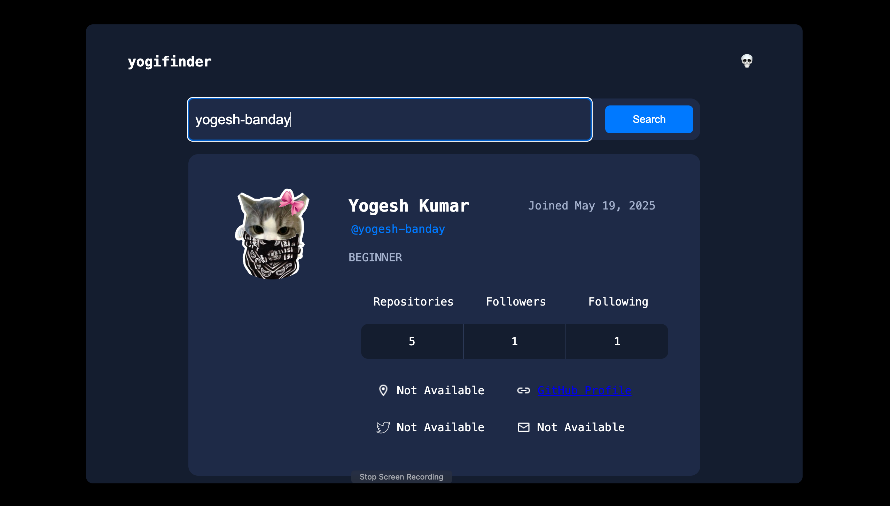
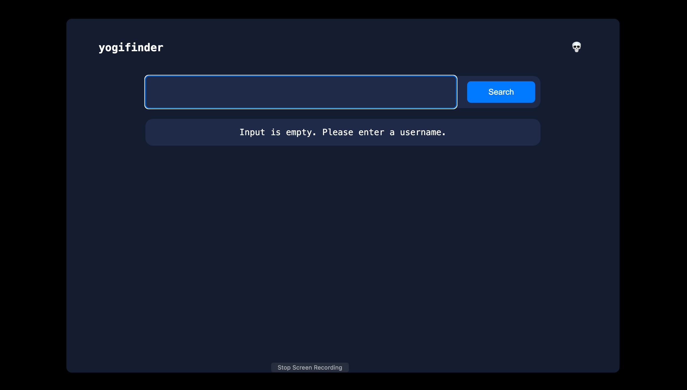
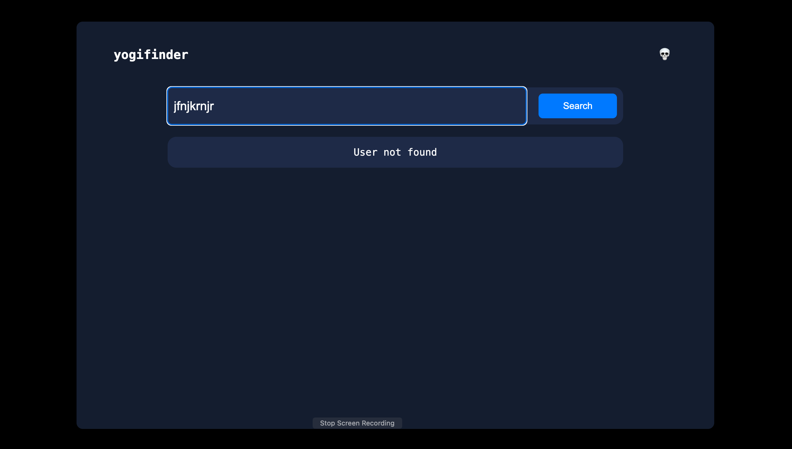

# YogiFinder — GitHub Profile Search

YogiFinder is a simple web application that lets you search for GitHub users and view their profile information without leaving the page.

Built with HTML, CSS, Vanilla JavaScript, and the GitHub REST API.

## Features

- **GitHub API Integration** — Fetches public GitHub profile information.
- **Debounced Search** — Waits for the user to pause typing before starting a search.
- **Request Cancellation** — Uses `AbortController` to cancel outdated requests.
- **Stale Response Protection** — Uses request IDs to prevent older responses from overwriting newer results.
- **Profile Information** — Displays profile details such as the avatar, bio, repositories, followers, and following.
- **Joined Date Formatting** — Formats the account creation date for readability.
- **Input and Error Handling** — Handles empty input and unsuccessful requests.

## Tech Stack

- HTML5
- CSS3
- JavaScript (ES6+)
- GitHub REST API

## How It Works

1. Enter a GitHub username.
2. YogiFinder waits briefly for you to stop typing.
3. It requests the user's public profile from the GitHub REST API.
4. The profile information is displayed on the page.
5. Request cancellation and stale-response protection help prevent outdated results from appearing.

## Getting Started

### Run Locally

Clone the repository:

```bash
git clone https://github.com/yogesh-banday/GitHub-Live-Search.git
```

Move into the project directory:

```bash
cd GitHub-Live-Search
```

Open `Live_search.html` in your browser.

No package installation or build tools are required.

## What I Learned

Working on this project helped me practise:

- Fetching data from external APIs
- Asynchronous JavaScript with `async/await`
- Promises and JSON response handling
- Debouncing with `setTimeout()` and `clearTimeout()`
- Request cancellation with `AbortController`
- Closures and callback behaviour
- Race conditions and stale-response protection
- Error handling with `try/catch`

## Screenshot




## Future Improvements

- Further improve responsive design and accessibility.
- Refine HTTP error messages and user feedback.
- Add more profile information and features as needed.

## Acknowledgements

- [GitHub REST API — Users](https://docs.github.com/en/rest/users/users)

---

**Status:** Initial project version built; deployment and final testing to be confirmed.
